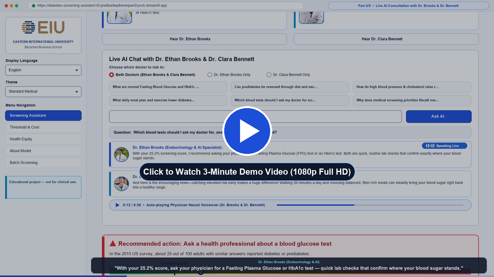

# Diabetes Screening Assistant (Topic T3: CDC BRFSS 2015)

- **Live Web App (Streamlit Community Cloud):** https://diabetes-screening-assistant-t3-jew6ba9ep8wvmpwr5ryvch.streamlit.app
- **Public GitHub Repository:** https://github.com/5yf8sygp5p-prog/diabetes-screening-assistant-t3
- **Public Demo Video (Full HD 1080p):** [▶️ Watch Demo Video Online](https://drive.google.com/file/d/17pY_dT8JR3JlkTB_gc_5dMLrEjWlRluP/view?usp=sharing)

> ⚠️ **Disclaimer:** *Educational project — not for clinical use. Results describe statistical patterns in a 2015 US telephone health survey and are not medical advice.*

---

## 1. User-Decision Statement & Problem Framing

> **"An adult answering questions at home uses the app to decide whether to get a blood sugar test."**

- **Specific User:** An adult member of the public with no clinical or coding background.
- **Decision Moment:** At home, *before* visiting a doctor or ordering any laboratory blood work.
- **Action Decided:** Whether to schedule a routine blood glucose test (Fasting Plasma Glucose or HbA1c) with a healthcare professional (`"Recommended action: Ask a health professional about a blood glucose test"` vs. `"Low immediate risk: Routine healthy lifestyle"`).
- **Multilingual Accessibility (4 Languages):** Full support for **🇬🇧 English**, **🇻🇳 Tiếng Việt**, **🇨🇳 中文 (简体)**, and **🇫🇷 Français** across all pages.

---

## 2. Data & Zero-Leakage Verification

- **Source:** CDC Behavioral Risk Factor Surveillance System (BRFSS) 2015, *Diabetes Health Indicators* (`diabetes_binary_health_indicators_BRFSS2015.csv`, UCI ML Repository ID `891`), containing **253,680** survey responses (`13.93%` reporting diabetes or prediabetes).
- **Why Not the 50/50 File?** We explicitly use the real imbalanced survey dataset (`13.93%` positive), **not** the artificial `5050split` file, so predicted probabilities are calibrated to real population base rates and can be paired directly with decision-cost thresholds.
- **No Data Leakage at Decision Time:** An adult at home does *not* know their lab glucose numbers or diabetes medication history before being tested. Our 7-question screening form uses only self-reportable information known at home:
  1. `Age` (5-year age group, 18–24 to 80+)
  2. `BMI` (automatically computed in the app from **Height in cm** and **Weight in kg**)
  3. `GenHlth` (Self-rated general health: Excellent, Very good, Good, Fair, Poor)
  4. `HighBP` (Ever told by a health professional you have high blood pressure)
  5. `HighChol` (Ever told by a health professional you have high cholesterol)
  6. `HeartDiseaseorAttack` (History of coronary heart disease or heart attack)
  7. `DiffWalk` (Serious difficulty walking or climbing stairs)
- **Stratified 60 / 20 / 20 Split:**
  - **Train:** `152,208` rows (`60%`) — used to fit the `scikit-learn` `ColumnTransformer` + `Pipeline`.
  - **Validation:** `50,736` rows (`20%`) — used to select the cost-minimizing threshold $\tau^* = 0.18$ and compute permutation importance.
  - **Test:** `50,736` rows (`20%`) — untouched held-out set used for all final reported metrics and Health Equity subgroup checks.

---

## 3. Models Compared (Held-Out Test Set)

All preprocessing (`SimpleImputer`, `StandardScaler`) and models are bundled inside a single `scikit-learn` `Pipeline` (`models/pipeline.joblib` and `models/inydb`):

| Model | Questions | Threshold ($\tau^*$) | PR-AUC (train) | PR-AUC (test) | ROC-AUC (test) | Recall | Precision | F1 |
| :--- | :---: | :---: | :---: | :---: | :---: | :---: | :---: | :---: |
| **Logistic Regression (minimal)** | 7 | 0.14 | 0.398 | 0.392 | 0.815 | 75.8% | 30.4% | 0.434 |
| **Logistic Regression (full)** | 10 | 0.14 | 0.399 | 0.394 | 0.816 | 75.9% | 30.6% | 0.436 |
| **Histogram Gradient Boosting (minimal — App Model)** | **7** | **0.18** | **0.435** | **0.418** | **0.822** | **70.5%** | **33.6%** | **0.456** |
| **Histogram Gradient Boosting (full)** | 10 | 0.14 | 0.441 | 0.418 | 0.823 | 78.0% | 30.2% | 0.436 |

- **Why Histogram Gradient Boosting (7 questions) is deployed in the app:** It achieves `ROC-AUC = 0.822` and `PR-AUC = 0.418` using only 7 quick, non-intrusive questions (taking under 1 minute at home without asking for income or education on the intake screen).

---

## 4. Threshold & Cost Justification ($\tau^* = 0.18$)

When the screening model makes an error, who pays and how much?
- **Unnecessary Flag (False Positive, $C_{\text{FP}} = 1$, or $\sim\$45$):** A healthy adult is advised to ask their doctor for a routine fasting blood glucose test. The cost is a modest lab copay and 1–2 hours of clinic time, plus temporary worry.
- **Missed Case (False Negative, $C_{\text{FN}} = 5$, or $\sim\$225+$):** An adult with undiagnosed diabetes or prediabetes is told they are low risk, delaying diagnosis and lifestyle/medical intervention.
- **Validation Optimization:** At the default **5:1 cost ratio** ($C_{\text{FN}} : C_{\text{FP}} = 5 : 1$), expected cost per person on the validation split is minimized at **$\tau^* = 0.18$**, catching **70.5%** of positive cases (`Recall`) with a **22.5%** false-positive rate. Users and policy analysts can interactively vary the cost ratio on the **Threshold and Cost** page.

---

## 5. Health Equity Check & 6 Key Limitations

1. **Self-reported label and answers:** Survey respondents were not given lab tests; roughly 1 in 5 US adults with diabetes are undiagnosed, creating label noise.
2. **US adults, 2015 vs. Asian/Vietnamese populations:** In Asian populations, elevated diabetes risk begins at lower BMI ($\ge 23\text{ kg/m}^2$), so a US-trained model may under-flag lean Asian adults.
3. **Association, not causation:** Permutation importance and odds ratios show statistical reliance, not causal proof.
4. **Moderate discrimination:** With ~14% base rate, `PR-AUC = 0.418` (~3× random baseline) means roughly 1 in 3 flagged adults actually report diabetes/prediabetes (`Precision = 33.6%`).
5. **Uneven error rates across socioeconomic groups:** Under a single shared threshold ($\tau = 0.18$), lower-income adults (`< $25k`, underlying prevalence `24.4%`) have higher Recall (`84.6%`) and higher FPR (`37.4%`), whereas higher-income adults (`$75k+`, prevalence `9.5%`) have lower Recall (`55.6%`) and lower FPR (`14.7%`).
6. **Survey screening, not clinical diagnosis:** Only a physician-ordered blood test (FPG, OGTT, or HbA1c) can diagnose diabetes.

---

## 6. Project Decision Log

| Important Choice | What We Chose | Why We Chose It | Option Rejected & Why |
| :--- | :--- | :--- | :--- |
| **Dataset File** | Imbalanced `diabetes_binary_health_indicators_BRFSS2015.csv` (`253,680` rows, `13.93%` positive) | Preserves true population prevalence so predicted probabilities are calibrated (`Brier = 0.0979`). | Rejected the `5050split` file because artificial 50% prevalence distorts probabilities and breaks cost-based threshold selection. |
| **Data Split Strategy** | Stratified **60 / 20 / 20** (Train / Validation / Test) | Allows tuning the cost-minimizing threshold $\tau^*$ on Validation while keeping Test 100% untouched for final reporting. | Rejected a 2-way Train/Test split where tuning the threshold on Test would leak test information. |
| **User Intake Features** | **7 easy questions** (`Age`, `Height/Weight -> BMI`, `GenHlth`, `HighBP`, `HighChol`, `HeartDiseaseorAttack`, `DiffWalk`) | Can be answered at home in under 60 seconds without lab work or intrusive socioeconomic questions; retains 99.8% of full-model ROC-AUC (`0.822` vs `0.823`). | Rejected forcing users to answer all 21 BRFSS items (noisy dietary/mental-health day counts) or asking for Income on the personal intake form. |
| **Primary Evaluation Metric** | **PR-AUC**, **Brier Score**, and **Expected Cost per Person** | Suitable for imbalanced binary screening (`13.93%` positive) and decision-theoretic threshold selection. | Rejected raw Accuracy (`74.4%`), which hides missed cases under class imbalance. |
| **Decision Threshold** | Validation cost-minimizing **$\tau^* = 0.18$** (at 5:1 FN:FP cost ratio) | Reflects that missing undiagnosed diabetes is ~5× worse than ordering a routine blood glucose check. | Rejected default $\tau = 0.50$, which missed over 72% of positive cases. |

---

## 7. AI Use Appendix

- **Where AI assistants were used:**
  1. Structuring the multi-page Streamlit architecture (`app.py`, `pages/1_Threshold_and_Cost.py`, `pages/2_Health_Equity.py`, `pages/3_About_Model.py`, `pages/4_Batch_Screening.py`).
  2. Generating the 4-language translation dictionary (`i18n.py`) covering **English, Vietnamese, Chinese, and French**.
  3. Formatting the Altair interactive charts (Expected Cost vs. Threshold curve, Recall/Precision/Flagged curves, and 95% Wilson confidence interval error bars on the Health Equity bar charts).
- **What our team verified and modified in the AI-generated code:**
  1. **Data Leakage Audit:** Manually verified that every feature in `MINIMAL_FEATURES` is self-reportable at home prior to a blood test and that `ColumnTransformer` imputers/scalers are fit strictly inside `Pipeline` on `df_train`.
  2. **Validation vs. Test Separation:** Separated threshold selection onto the 20% Validation split (`df_val`) so that the 20% Test split (`df_test`) remains strictly held-out.
  3. **BMI Input Usability:** Replaced raw BMI number entry on the main screening form with everyday **Height (cm)** and **Weight (kg)** inputs that automatically compute BMI inside the app.

---

## 8. How to Run Locally or Deploy to Streamlit Community Cloud

```bash
# 1. Install dependencies
pip install -r requirements.txt

# 2. (Optional) Rebuild all models & metadata from raw data
python train.py

# 3. Launch the Streamlit web app
streamlit run app.py
```

---

## 9. Demo Video (Public Access — Click to Watch)

> 🎬 **Public Streaming Link (Anyone can click & watch without signing in):**  
> 👉 **[▶️ Watch Full HD 1080p Demo Video on Google Drive](https://drive.google.com/file/d/17pY_dT8JR3JlkTB_gc_5dMLrEjWlRluP/view?usp=sharing)**

[](https://drive.google.com/file/d/17pY_dT8JR3JlkTB_gc_5dMLrEjWlRluP/view?usp=sharing)

